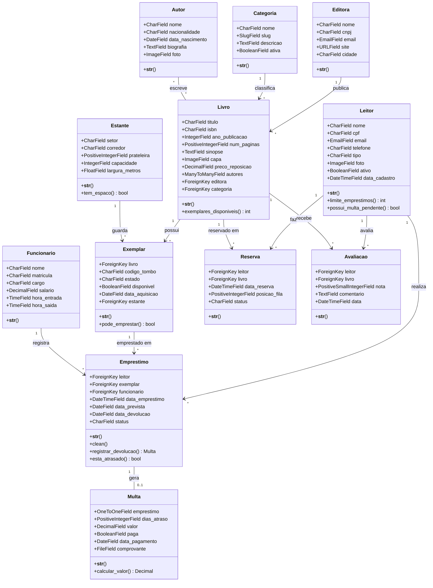

# Diagrama de Classes — Sistema de Biblioteca

Diagrama de classes (UML) do sistema, em **Mermaid** (`classDiagram`).

> **Cláusula 1.4/1.5 do contrato:** este diagrama deve ser apresentado ao
> professor e **validado antes da implementação** dos apps.
>
> Para exportar a imagem (PNG): copie o bloco Mermaid abaixo e cole em
> <https://mermaid.live>, depois use *Actions → Download PNG*.

## Diagrama

## Tipos de dados usados (cláusula 1.8)

| Tipo | Contexto lógico |
|------|-----------------|
| CharField | nomes, ISBN, CPF, códigos, cargos |
| TextField | sinopse, biografia, descrição, comentário |
| IntegerField / PositiveIntegerField / PositiveSmallIntegerField | ano, páginas, prateleira, capacidade, dias de atraso, nota |
| FloatField | largura da estante (medida física) |
| DecimalField | preço de reposição, salário, valor da multa |
| BooleanField | ativa, disponível, ativo, paga |
| DateField | nascimento, aquisição, devolução prevista/real |
| DateTimeField | empréstimo, reserva, avaliação, cadastro |
| TimeField | turno do funcionário |
| EmailField / URLField / SlugField | contato, site, URL amigável |
| ImageField | capa do livro, foto do autor e do leitor |
| FileField | comprovante de pagamento da multa |

## Regra de negócio central (classe Emprestimo)

1. Exemplar precisa estar `disponivel` e com estado diferente de danificado/perdido.
2. Leitor precisa estar `ativo` e sem multa pendente.
3. Limite simultâneo: aluno 3, comunidade 2, professor 5.
4. Prazo: 14 dias (professor: 21 dias).
5. Ao emprestar: `exemplar.disponivel = False`.
6. Na devolução: registra data, status `devolvido` e libera o exemplar.
7. Devolução em atraso gera `Multa` (R$ 1,00 por dia).
8. Ao devolver, a primeira `Reserva` aguardando vira `disponivel`.
